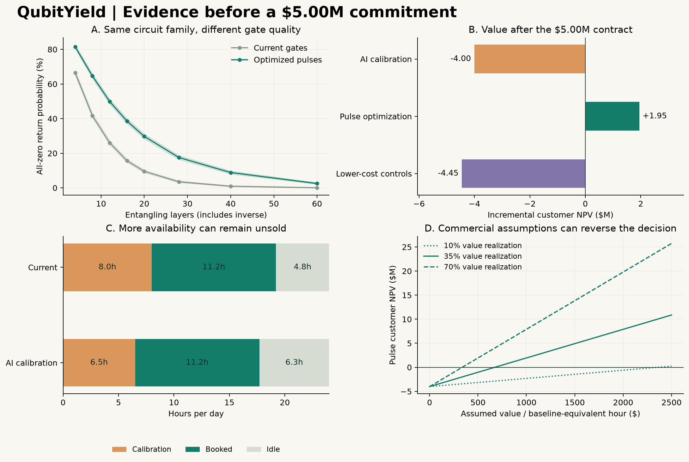

# QubitYield

### What is a better quantum processor actually worth?

QubitYield turns a hardware claim into a reproducible experiment, a capacity model,
and a commercial decision. It tackles **Challenge 4: The Calibration Contract** from
Columbia's Lab-to-Market Quantum & AI hackathon: choose between AI calibration,
better two-qubit gates, and cheaper controls for a proposed **$5 million, three-year contract**.

The result is a working experiment workbench: a React dashboard, a Python scientific
engine, durable experiment history, bounded background jobs, commercial stress tests,
pricing analysis, an executable notebook and an executive memo. All case data are
fictional. All quantum results are simulated.



[Read the decision memo](artifacts/decision_memo.pdf) ·
[Explore the notebook](notebooks/calibration_contract.ipynb) ·
[Inspect the raw results](artifacts/analysis.json) ·
[Review the assumptions](docs/economic-method.md)

Version 0.2 expands the original experiment into five connected screens. The
[implementation plan](docs/roadmap.md) and [release audit](docs/release-audit.md)
record the work, verification and any remaining delivery blockers.

## The decision, including what could reverse it

Prioritize a **gated pulse optimization pilot**. The initial calibration-first
hypothesis does not survive the default demand assumptions: recovering time does
not create new bookings when existing demand already fits into available hours.
The proposed contract still needs a demonstrated application-value mechanism.

| Default experiment or scenario | Computed result |
| --- | ---: |
| Workload | 20 qubits, 20 parallel entangling layers, 200 CX gates |
| Baseline mirror return | 772 / 8,192 shots, or 9.42% |
| Optimized mirror return | 2,468 / 8,192 shots, or 30.13% |
| Successful-shot throughput, including assumed overhead | 3.126 times baseline |
| AI calibration: additional bookings at current demand | 0 hours/year |
| Pulse contract: customer NPV with additional-output value | +$1.945 million |
| Pulse contract: customer NPV with fixed-output savings | -$2.100 million |

These are seed-7 results under the saved [default scenario](data/default_scenario.json).
The financial cases assume $1,000 per valued hour, 35% commercial realization,
100 microseconds of fixed shot overhead, a six-month rollout, and 12% discounting.
Those numbers are analyst assumptions, not customer measurements or market prices.

The distinction that changes the recommendation is explicit in the code:

```text
additional_output:    valued hours = B * (R - 1)
fixed_output_savings: valued hours = B * (1 - 1/R)
```

Here B is annual baseline booked hours and R is the benchmark throughput ratio.
The first case needs valuable additional output within unchanged bookings. The
second values time saved delivering the same output. A faster benchmark alone
does not establish either source of money. The $5 million contract fails the
second case, even with the same hourly value and realization assumptions.

## Run the workbench

Requirements: **Python 3.11+**, **Node.js 20.19+** and npm. Node 22 is recommended.
Run these commands from the repository root; the activation command below is for
macOS/Linux. On Windows, activate `.venv\Scripts\Activate.ps1` instead.

```sh
python3 -m venv .venv
source .venv/bin/activate
python -m pip install -e '.[dev,research]'
cd web
npm ci
npm run build
cd ..
qubityield serve
```

Open **http://127.0.0.1:8000**. API documentation is at **/docs** on the same server.
No cloud credentials, QPU account, API key, or external LLM service is required.
The base install `python -m pip install -e .` runs the engine and dashboard;
`dev` adds tests and linting, while `research` adds Qiskit and notebook execution.

For a locked Python environment, use `uv sync --frozen --extra dev --extra research`.
The npm dependency graph is pinned by `web/package-lock.json`.

### What you can do in the interface

- Compare the current system, automated calibration, pulse optimization, and controls.
- Change physical and commercial assumptions and run a matched experiment.
- Inspect depth scaling, sampling intervals, capacity, cash flows, and a decision map.
- Switch between additional-output value and fixed-output cost savings.
- Read the assumption ledger, save local scenario comparisons, and export evidence.
- Queue new experiments, watch progress and cancel work that has not started.
- Reopen durable results, edit labels/notes/tags, rerun inputs and compare saved experiments.
- Sweep commercial assumptions and distinguish grid coverage from probability.
- Compare the customer's price ceiling with vendor margin and discounted cash-flow floors.
- Import validated scenario/evidence JSON and share links to saved catalog scenarios.

For a no-install look, download and open [web/preview/index.html](web/preview/index.html).
This self-contained offline preview lets you explore **eight precomputed scenarios**,
including both valuation modes, backlog, and the alternative noise interpretation.
It loads each scenario's exact saved inputs and evidence. Draft edits are clearly marked;
it **cannot evaluate arbitrary new scenarios** without the Python API. The Strategy
screen also includes saved baseline stress and pricing evidence. History and fresh
calculations require the local server. The preview is not a live hardware feed or an account service.

Completed queued runs are stored in a local SQLite ledger, outside the repository
by default. Set `QUBITYIELD_DATA_DIR` to choose its location. Two workers share the
same compute limit as synchronous API requests, with at most eight pending jobs.
The [API contract](docs/workbench-api.md) explains cancellation, restart recovery,
metadata editing and record deletion.

## Reproduce the submission

With the virtual environment active, the Make targets provide the full workflow:

```sh
make setup       # install Python extras and npm dependencies
make check       # lint, backend tests, frontend tests, and production web build
make reproduce   # experiments, reports, Aer checks, executed notebook, SHA-256 manifest
make serve       # build the dashboard and serve it locally
```

`make` is optional. The equivalent reproduction commands are:

```sh
qubityield reproduce
python scripts/validate_qiskit.py
python scripts/execute_notebook.py
cd web
npm run build
npm run build:preview
cd ..
python scripts/build_manifest.py
qubityield verify-manifest
```

To evaluate a different scenario, copy the default JSON, edit its assumptions,
and run `qubityield evaluate --scenario my_scenario.json --output my_results.json`.
Use `qubityield reproduce --quick` to skip multi-seed robustness during iteration.
Rebuild the offline preview with `cd web && npm run build:preview`.

### Compare, stress-test and price from the terminal

```sh
qubityield compare --scenarios data/comparison_scenarios.json --output artifacts/comparison.json --csv artifacts/comparison.csv
qubityield stress --output artifacts/stress.json
qubityield pricing --output artifacts/pricing.json
qubityield verify-manifest --manifest artifacts/manifest.json --root .
```

`compare` accepts 1 to 16 uniquely named scenario objects and preserves each full
result. `stress` and `pricing` accept `--request request.json` using the same schemas
as the API. See [decision-tools.md](docs/decision-tools.md) for the exact assumptions
and examples. Inputs reject duplicate keys and nonfinite values. CSV exports keep
untrusted text inert in spreadsheet programs. A manifest mismatch exits with code 1;
invalid input exits with code 2. Integrity hashes detect changes, not authorship.

The default stress grid contains 125 assumption combinations. An option's win
coverage counts the cells it wins; it is not a probability of success. With the
illustrative $500,000 implementation cost, $150,000 annual support cost and 60%
target margin, the nominal vendor floor is $2.375M. The default 30% value-share
target for pulse optimization falls below that floor, even though joint surplus
exists. The tool exposes that negotiation conflict instead of inventing a quote.

### Reviewable outputs

| Deliverable | File |
| --- | --- |
| Phase 1 hypothesis and experiment plan | [docs/hypothesis.md](docs/hypothesis.md) |
| Executive recommendation | [artifacts/decision_memo.pdf](artifacts/decision_memo.pdf) and [Markdown](artifacts/decision_memo.md) |
| Executable analysis | [notebooks/calibration_contract.ipynb](notebooks/calibration_contract.ipynb) |
| Counts, intervals, inputs, and provenance | [artifacts/analysis.json](artifacts/analysis.json) |
| Comparison table and scenario stress tests | [artifacts/options.csv](artifacts/options.csv), [artifacts/scenarios.csv](artifacts/scenarios.csv) |
| Multi-seed robustness | [artifacts/multi_seed.json](artifacts/multi_seed.json) |
| Commercial stress envelope | [artifacts/stress.json](artifacts/stress.json) |
| Vendor/customer pricing constraints | [artifacts/pricing.json](artifacts/pricing.json) |
| Named batch comparison | [artifacts/comparison.json](artifacts/comparison.json) and [CSV](artifacts/comparison.csv) |
| Independent simulator comparison | [artifacts/qiskit_validation.json](artifacts/qiskit_validation.json) |
| Figure for submission or presentation | [PNG](artifacts/decision_landscape.png) and [SVG](artifacts/decision_landscape.svg) |

Reproduction also writes cash-flow, depth, sensitivity, and decision-map CSVs.
The manifest records hashes of source, input, and evidence files. Scientific
counts are seeded; timestamps and PDF metadata can change when regenerated.

## How it works

The Python engine is the single authority for calculated results. The frontend
renders returned evidence instead of implementing a second financial model.

| Layer | Implementation |
| --- | --- |
| Input contracts | Pydantic scenarios, explicit case claims, and an assumption ledger |
| Circuit experiment | Seeded Clifford mirrors on alternating ring matchings |
| Primary simulator | NumPy Pauli-frame trajectories with propagated and cancelling faults |
| Independent reference | Qiskit Aer stabilizer runs and exact small-system density matrices |
| Commercial model | Demand, usable availability, throughput, rollout, NPV, and price ceilings |
| Strategy | Bounded sensitivity grids, maximin/minimax-regret comparisons, and vendor/customer pricing |
| Persistence and scheduling | SQLite ledger, immutable evidence, two workers, bounded queue, restart recovery |
| Service and interface | FastAPI, React, TypeScript, and Recharts |
| Reproduction | CLI, notebook, generated reports, CSV/JSON evidence, and integrity manifest |

See [architecture](docs/architecture.md), [quantum method](docs/quantum-method.md),
and [economic method](docs/economic-method.md) for the equations and boundaries.
The [pilot plan](docs/pilot-plan.md) turns the recommendation into validation gates.

## Evidence and limitations

The [release audit](docs/release-audit.md) records the final test counts and findings.
Run `make check` and the validation script to verify the current revision.
Tests cover independent
dense-channel calculations, mirror identity, 200 gates in 20 parallel layers,
sampling, invalid inputs, payment timing, sunk costs, and the economic reversal.

The primary simulator and Aer share a gate specification but implement channels
and evolution separately. Additional invariant tests check that shared circuit.
Agreement validates this software model, not a vendor's performance claims.

Several assumptions remain deliberately visible:

- **Case claims versus assumptions:** [case_facts.json](data/case_facts.json) records the
  fictional brief. Dollar values, overhead, pilot transfer, and monetization are added assumptions.
- **Noise:** reported gate error is interpreted as total average infidelity. The default
  does not add gate-time coherence loss twice. `control_only` tests a different reading.
- **Circuit scope:** local gates and default readout are ideal. Noise is independent and
  stationary. The relaxation sensitivity uses a Pauli twirl, not full amplitude damping.
- **Metric scope:** all-zero mirror return is not general application correctness.
  The benchmark does not establish quantum advantage or production usefulness.
- **Capacity scope:** a 100-qubit processor is not assumed to run five independent jobs.
  Extra availability is not automatically extra demand or revenue.
- **Pricing:** a zero-NPV ceiling is not a recommended price. Some negative-value
  options cannot break even even with a free contract. Vendor cost inputs are
  illustrative assumptions, since the case supplies no vendor cost data.
- **Deployment:** this is a local research prototype without authentication. A public
  multi-user service and a hardware execution adapter are outside the implemented scope.

The CI workflow verifies the model, executes the notebook, builds the demo, and
deploys the verified standalone preview to GitHub Pages on successful main-branch runs.
Pull requests run verification without deploying.

An optional [Dockerfile](Dockerfile) packages the dashboard and local API.
The documented development and validation path is the Python/npm workflow above.
To preserve local history in Docker, mount a writable volume at the directory
selected by `QUBITYIELD_DATA_DIR`. The image uses UID 10001 and binds the process to
port 8000. Publish the container port only to localhost for this unauthenticated app.
The release audit states whether the image itself was exercised.

## Sources and authorship

Methods and primary references are collected in [docs/references.md](docs/references.md).
The project was built with substantial AI assistance, permitted by the hackathon brief;
the [assistance disclosure](docs/ai-assistance.md) describes that contribution.

Created for Jasper Sands. Released under the [MIT License](LICENSE).
