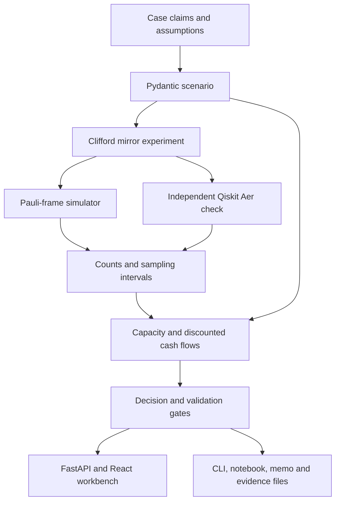

# Architecture

The Python engine is the single authority for results. The React dashboard submits
validated scenarios and renders the returned evidence; it does not contain a separate
financial formula implementation.

## Boundaries

- `quantum.py`: seeded circuits, stochastic Pauli channels, propagation, intervals and
  multi-seed comparisons. NumPy is sufficient for the primary experiment.
- `qiskit_adapter.py`: optional independent simulator and exact small-system reference.
- `models.py`: strict field names, finite numeric bounds, physical coherence constraints.
- `economics.py`: time eligibility, demand-limited bookings, benchmark-rate normalization,
  deployment delay, fee timing, NPV, price ceilings and explicit assumptions.
- `analysis.py`: physical-input-keyed cache, scenario provenance and evidence assembly.
- `decision_tools.py`: bounded commercial stress grids, conditional sampling envelopes,
  vendor cost floors, discounted cash timing and customer price ceilings.
- `storage.py`: SQLite experiments and job metadata, transactional completion,
  immutable scientific evidence, editable labels/notes/tags and corruption detection.
- `jobs.py`: two background workers and an eight-job queue sharing simulation slots
  with synchronous calls; queued cancellation and explicit restart recovery.
- `portable.py`: bounded JSON files, named batch comparison, spreadsheet-safe CSV
  and path-validated integrity verification.
- `api.py`: typed HTTP interface, request-size limit, bounded simulation concurrency and
  optional static frontend hosting.
- `reporting.py`: generated figures, CSV tables, notebook and executive memo.
- `web/`: responsive React/TypeScript interface with scenario controls, experiment lab,
  assumptions ledger, persistent history, commercial strategy, imports and exports.

## Reproducibility and state

The server uses Python's bundled SQLite and needs no external database service.
The simulator's random seeds are explicit; changing a financial assumption cannot silently
reuse a mismatched physical experiment. Cached objects are copied before returning them.
Completed asynchronous jobs atomically save an experiment and its provenance. Scientific
results are immutable through the API; labels, notes and tags may be edited. SHA-256 checks
detect corruption but do not authenticate a record against deliberate database modification.

`QUBITYIELD_DATA_DIR` chooses the local ledger directory. The default is
`~/.local/share/qubityield` on Linux, or the platform's local application-data directory
when configured. Keep that directory on a persistent, private volume if the service runs
in a container. Only one server may own it at a time. A directory lock prevents a second
process from failing another server's in-flight jobs during startup recovery.

The queue has two workers and at most eight pending jobs. Synchronous endpoints use the
same two compute slots. Queued work may be cancelled; running Python calculations cannot
be safely interrupted. Graceful shutdown cancels waiting jobs and waits for running work.
After a crash, queued/running records become failed with an interruption explanation.
The server never silently resubmits scientific work after a restart.

Browser comparison snapshots stay in local storage and are separate from server history.
JSON exports preserve the complete scenario and raw simulation counts. The standalone
preview bundles eight exact saved analyses and default strategy evidence. It has no job
queue or persistent server ledger and cannot evaluate arbitrary new physics or prices.
Shared links identify a saved catalog scenario and screen only; they do not transmit
custom scenarios or personal experiment notes to a separate service.

The app is a local research prototype. It has no authentication or multi-tenant isolation.
The default server binds to 127.0.0.1; the Docker run command also binds the published port
locally. A public production deployment would still need authentication, tenant isolation,
resource quotas, retention policy and operational monitoring. Bounded local concurrency
does not supply those multi-user controls.

## What is deliberately absent

There is no paid QPU execution, fabricated live hardware feed, external LLM dependency,
customer database or implied production accuracy. The Qiskit integration is an independent
verification path. A hardware adapter is future work contingent on a real customer pilot.

